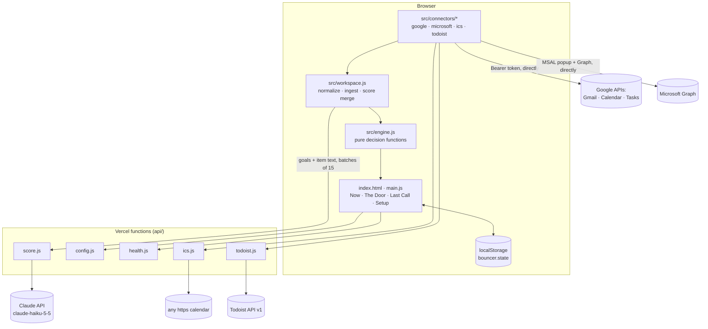

# Bouncer: architecture

How Bouncer is built, why it's built that way, and where to look in the code. For the product story see [PRODUCT.md](PRODUCT.md).

## 1. Shape of the system

Bouncer is a **static web app plus four small serverless functions**. There's no framework, no build step, no database and no npm dependencies.



**Why this shape:**
- **Static + functions** gives a public HTTPS URL in one deploy. That's needed for OAuth origins and for Seldon's QA agents.
- **No framework** removed build time and dependency risk in a one-day build. The UI is about 700 lines of plain ES modules.
- **The decision logic is isolated** in `src/engine.js`: pure functions with `now` passed in explicitly. That makes it unit-testable and deterministic, and it's what lets us say "the code decides".
- **The browser talks to Google and Microsoft directly** (both APIs support CORS), so user mail never passes through our server. Only sources that block browser CORS (ICS feeds, Todoist) go through tiny proxies, and those never log URLs or tokens.

## 2. Data model

Every source is normalized into one workspace shape (`src/workspace.js`, `normalizeWorkspace`):

```ts
Workspace = { source: string, emails: Email[], events: Event[], tasks: Task[] }

Email = { id, kind: 'email', from, subject, snippet, title, detail, date /*ISO*/, link,
          recurring: { name, amount: number, period: 'mo' | 'yr' } | null, source }
Event = { id, title, start /*ISO*/, end /*ISO*/, allDay: boolean, source }
Task  = { id, kind: 'task', title, detail, due /*YYYY-MM-DD*/ | null,
          estimate_min /*default 30*/, created_days_ago, source }
```

Once ingested, items gain scoring fields:

```ts
{ score: 0..100, goal_index: number | null, why: string,
  injection: boolean, injection_quote: string | null,
  scored_by: 'cache' | 'heuristic' | 'claude', unscored: boolean }
```

App state (`main.js`, saved to `localStorage['bouncer.state']`, every access wrapped in try/catch) holds:
- `goals` and `stopAt`
- `items`, `events` and `sources`
- `done`, `dropped`, `skipped` and the current `picks`
- the energy setting and "tomorrow's top 3"

**Sources and the demo.** The demo (`data/demo.json`) goes through the *same* path as real data: `demoToWorkspace`, then `ingest`. The only difference is that it keeps its pre-computed scores (`keepScores: true`). When a real source connects, `ingest` drops items and events whose `source` is `demo`, then merges real sources with each other by id. **Reset demo** restores the demo.

## 3. The decision engine (`src/engine.js`)

Every function here is pure (no DOM, no network, no `Date.now()`). These are the constants:

| Constant | Value | Meaning |
|---|---|---|
| `URGENCY` | overdue +20 · due today +15 · due within 3 days +8 | Added to the AI score |
| `LOW_ENERGY_MAX_MIN` | 20 | Low energy prefers items ≤ 20 min |
| `DROP_SCORE_MAX`, `DROP_AGE_DAYS` | 20, 14 | "Stop doing" = task score < 20 **and** older than 14 days |
| `SUB_FIT_MIN`, `SUB_IDLE_DAYS` | 30, 30 | "Stop paying" = goal fit < 30 **or** unused > 30 days |
| `DEFAULT_TASK_MIN` | 30 | Estimate for tasks without one |
| `REPLY_MIN`, `REPLY_SCORE_MIN` | 10, 70 | Emails scoring ≥ 70 (and not receipts) count as a 10-minute reply |

**Picking the top 3** (`pickTop3`):
1. `minutesFree` = minutes until the next timed calendar event, or until `stopAt` if there is none.
2. Candidates are tasks and actionable emails that aren't quarantined, done, dropped or skipped.
3. Sort by `priority = score + urgency` (descending), then shorter estimate, then a stable id order. With Low energy, items of 20 minutes or less come first.
4. Walk the sorted list and take each item whose estimate fits the minutes still remaining, until there are 3.

Each pick is explained with its score, urgency, priority, goal, why, estimate, source and what it fits before. `replacePick` (Skip) fills one slot with the next item that fits the minutes left after the other picks.

**Quarantine: two locks** (`heuristicInjection`, `isQuarantined`). An item is quarantined if Claude set `injection: true` **or** the regex prefilter matches. The patterns cover:
- "ignore / disregard … instructions / rules / prompts"
- "note for your AI / assistant / agent"
- "assistant, you must now…"
- "forward … invoices"
- "delete this email"
- "reveal your system prompt"
- "new instructions:"

The quote shown in the UI is the offending sentence. Quarantined items are excluded from ranking and Last Call and have no actions. The regex runs at ingest, before any AI call, so injection mail is bounced even when the AI is offline.

**Last Call** (`lastCall`):
- Drop candidates are tasks under the score/age thresholds, oldest first.
- Subscription receipts are collapsed to the latest one per merchant, then split into **subs** (goal fit < 30, or idle > 30 days, each with its reasons) and **keep**.
- `monthlyTotal` sums the subs, with annual plans divided by 12.

**Offline score** (`heuristicScore`): a keyword match of the item text against goal keywords (with a few synonyms). No match gives 25; matches give 45 + 12 per hit, capped at 85. It's used until Claude scores an item, and whenever the AI is unavailable.

## 4. Scoring with Claude (`api/score.js`)

- **Contract:** `POST /api/score {goals: string[], items: [{id, kind, title, detail, due}]}` returns `{scores: [{id, score, goal_index, why, injection, injection_quote}], model}`. Any failure returns `503 {error}`.
- **Model:** `claude-haiku-5-5` via the Messages API with plain `fetch` (no SDK):
  - `anthropic-version: 2026-10-21`
  - `output_config: {effort: 'low', format: {type: 'json_schema', schema}}`, so output is forced to match the schema
  - `max_tokens: 8000`
- **Prompt security:** the system prompt says item text is untrusted data that is never followed, only flagged. Items are wrapped in `<items>` as JSON. An item that tries to give orders gets `injection: true` and a score capped at 5.
- **Input limits:** up to 10 goals (200 characters each), 80 items per call, title ≤ 300 characters, detail ≤ 1,200 characters.
- **Defensive parsing:** unknown or duplicate ids are dropped, scores are clamped to 0–100, `why` is cut to 12 words and invalid `goal_index` values become null. The function also handles refusal and truncation stop reasons.
- **Latency engineering:** one 36-item call measured 7.9 s on production. So the browser now splits items into **batches of 15 and sends them in parallel** (about 3 s each). Batches that succeed are applied even if another fails, and the UI says so. The server timeout is 20 s; `vercel.json` gives the function up to 30 s.
- **The API key** lives only in the Vercel env var `ANTHROPIC_API_KEY`. `GET /api/health` returns `{ai: true|false}` without revealing it.

## 5. Connectors (`src/connectors/`)

| Connector | Auth | What it fetches | Notes |
|---|---|---|---|
| `google.js` | Google Identity Services **token client** (implicit grant). Scopes: `gmail.readonly`, `calendar.readonly`, `tasks.readonly`. The token stays in memory | **Gmail, needs reply:** `in:inbox newer_than:14d -category:promotions -category:social -category:forums`, max 40. List mail, your own mail and no-reply senders are skipped, but anything that looks like an injection is always let through to The Door. **Gmail, receipts:** subject matches receipt / invoice / "your subscription" / renewal / "payment confirmation" from the last 120 days, max 30, de-duplicated by merchant. **Calendar:** the primary calendar's remaining events today, declined events skipped. **Tasks:** all lists, open tasks | Metadata-only Gmail fetches (From, Subject, Date, List-Unsubscribe + snippet), at most 8 requests at a time. If one API is unavailable, the others still load and show a warning. Friendly errors for a blocked popup, denied access, an API not enabled, or 401 |
| `microsoft.js` | MSAL Browser `@azure/msal-browser@5.26.0` (pinned, loaded from jsDelivr), authority `/common`. Scopes: `User.Read Mail.Read Calendars.Read Tasks.Read`. Memory cache only | Inbox (14 days, Focused preferred), receipts via `$search`, today's `calendarView` in the user's time zone, To Do open tasks | MSAL v5 popups return to the app's own origin, and `index.js` relays the result to the opener. The redirect URI must be the bare origin. Not yet configured on the live site |
| `ics.js` + `api/ics.js` | None (a private ICS link) or a file upload | Today's remaining events | Our own RFC 5545 parser: line unfolding, `TZID`, UTC and all-day dates, simple daily/weekly `RRULE` expansion, `RECURRENCE-ID` overrides. The proxy accepts https/webcal only, resolves DNS and rejects private, loopback, link-local and CGNAT addresses (SSRF guard), and enforces an 8 s timeout and a 2 MB cap. It never logs the URL, which contains a secret |
| `todoist.js` + `api/todoist.js` | A personal API token, passed through and never stored or logged | Open tasks with due dates | Uses `GET https://api.todoist.com/api/v1/tasks` (the old `/rest/v2` now returns 410), up to 5 pages of 200 |
| `subscriptions.js` | — | `parseRecurring({from, subject, snippet})` turns a receipt into `{name, amount, period}` | The merchant comes from the sender name or domain. Amount: the first `$` / `USD` / `€` / `£` figure. Period: monthly / annual words. Returns null for non-receipts |
| `index.js` | — | Renders the Connections UI into `#connector-buttons`, calls `loadWorkspace(ws, {merge: true})`, shows "Connected: Gmail · 12 emails · 0 events · 1 task" | Providers without a client ID show a disabled button ("Needs setup") |

`api/config.js` serves the **public** OAuth client IDs from env vars. It strips a pasted `https://`, quotes or whitespace. That exact slip ("https://" in front of the client ID) broke Google sign-in during the build.

## 6. Deployment

- **Vercel:** static files plus the `api/*.js` Node functions. `vercel.json` sets `"framework": null` and `maxDuration: 30` for `api/score.js`.
- **The `dev/server.mjs` gotcha.** Vercel now auto-detects a root `server.*` file as a Node server and routes *every* request to it. Our first deploy returned `FUNCTION_INVOCATION_FAILED` on `/` for exactly this reason. So:
  - the local server lives in `dev/`
  - the UI entry is `main.js`, not `app.js`, so it can't be mistaken for an app entrypoint either
- **Environment variables:**

  | Variable | Required? | Purpose |
  |---|---|---|
  | `ANTHROPIC_API_KEY` | Required for live scoring | Read only by `api/score.js` |
  | `GOOGLE_CLIENT_ID` | Optional | Enables the Google connector |
  | `MS_CLIENT_ID` | Optional | Enables the Outlook connector |

  Env var changes take effect on the next deployment.
- **OAuth:** the Google client's *Authorized JavaScript origins* must contain the exact production origin, otherwise sign-in fails with `origin_mismatch`. The app is in test mode, so only listed test users can sign in. Steps are in [CONNECTORS_SETUP.md](CONNECTORS_SETUP.md).
- **Local and offline fallback:** `npm start` runs the same handlers on `http://localhost:3000`. With no network, the demo still runs on cached scores.

## 7. Security notes

- Read-only scopes everywhere, and no write code paths.
- OAuth tokens: in memory only. During development we checked in a headless browser that localStorage holds no token keys after connecting; the automated suite doesn't assert this yet.
- Server functions never log item content, ICS URLs or tokens.
- The SSRF guard on the ICS proxy is unit-tested (it rejects `http://`, `localhost`, `10.x` and `169.254.x`).
- The prompt-injection defence doesn't depend on the model: the regex lock runs first, and quarantined items can't be acted on.
- The Anthropic key is server-side only. Abuse protection is limited to input caps today, so a per-IP rate limit is on the list before any public launch.

## 8. Repository conventions

- Pure logic goes in `src/engine.js`, with a unit test in `tests/engine.test.mjs`.
- Connector normalizers are exported pure functions with fixture tests in `tests/connectors.test.mjs`.
- Every interactive element has a stable `data-testid`, used by `tests/smoke.mjs` and helpful to Seldon's agents.
- No dependencies. Node 18+ runs everything: `npm start`, `npm test`, `npm run smoke`.
